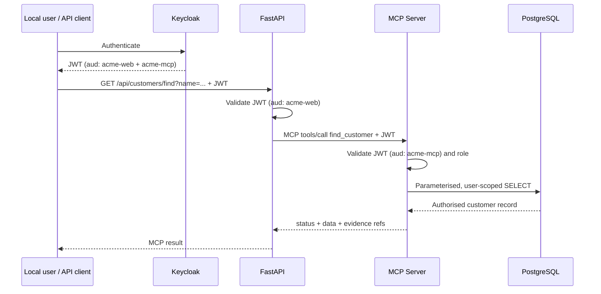

# Architecture — Implementation Slice W01–W05

## Containers

- `web` (custom FastAPI image): health endpoints; verifies Keycloak web-audience bearer JWT; MCP client proxy; explicit admin approval endpoint.
- `mcp` (custom image): real MCP v2 Streamable HTTP; validates Keycloak MCP-audience JWT; typed domain tools; PostgreSQL queries.
- `postgres`: 5 mandatory business tables, scoping, approval, audit; Alembic migration + idempotent fixture seed.
- `keycloak`: local `acme` realm with 3 business roles, 3 fictional users, OAuth web client and audience mappers.
- `redis`: runs but not yet consumed (W06-W08).
- `ollama`: runs/model pulled but not yet used (W07-W08).
- `db-init`: one-shot migration + seed, reuses `web` image.
- `model-init`: one-shot local-model download, reuses Ollama image.

## Trust boundaries

1. The bearer JWT is signed by Keycloak; both web and MCP independently validate signature, expiration, issuer, and **their own expected audience** using JWKS.
2. `principal_from_claims` derives roles solely from verified token claims, never caller-specified role fields.
3. MCP tool authorisation applies the role matrix, and the SQL repository independently restricts Sales reads to `user_customer_access`.
4. PostgreSQL only receives parameterised SQL, not unrestricted LLM-generated statements.
5. Controlled writes require an approval record created via a separate human-facing admin endpoint and a unique operation ID.
6. Redis is not a durable source of truth; future agent checkpoints remain in PostgreSQL.

## Sequence: customer lookup



## Security caveats / production evolution

- Demo uses Keycloak development mode, local-only ports, disposable passwords and a direct-password-grant smoke test. Never use this configuration as a production deployment.
- The web and MCP audiences are both added to one demo token. Future production integration should use token exchange or audience-specific delegation and OIDC Authorization Code + PKCE.
- Application `/api/approvals` requires bearer authentication and explicit `confirmed` input, but the complete browser CSRF/session model is W06.
- Secure secrets/rotation, full policy audit on denied actions, comprehensive input restrictions and distributed tracing remain outstanding.
- Build images and runtime have not yet been verified because the authoring environment has no Docker daemon.


## W06 browser identity and conversation layer

The browser uses Authorization Code + PKCE against Keycloak; FastAPI exchanges the code and verifies the ID/access JWTs against configured issuer, audience and realm JWKS, including the login nonce. A one-time Redis state is tied to a transient browser cookie. The browser receives only an opaque HttpOnly SameSite cookie; access and refresh tokens remain in a bounded Redis server-side session. Browser CSRF is checked before mutation.

The role-aware web page displays Keycloak-derived permissions without granting authority from HTML, prompts or form fields. Per-user conversation metadata is durable in `conversations` and `conversation_messages` tables via migration `0002_conversations`. Every conversation read and list filters by the authenticated `sub`. LangGraph execution and messages remain W08 work; no responses are simulated at W06. Test instructions and limitations are in `docs/W06-STATUS.md`.


## W07 read-only integration spike

`app.agent.probe` obtains disposable demo test tokens, reads live MCP tool schemas, sends only approved read tools to the local Ollama `/api/chat` endpoint, executes the model-selected MCP calls, and reports observed routing and evidence IDs. It does **not** bypass actual MCP transport by calling repository functions directly. The model receives tool outputs but **never receives access tokens**. This is a standalone prerequisite for W08's durable LangGraph runtime and is not wired into the browser chat endpoint yet.


## W08: graph execution and persistence

The `web` container now hosts a bounded `StateGraph` with two nodes: `reason` (model selects MCP tool calls) and `tools` (validates and executes read tools). A conditional edge terminates on a textual answer or error, and otherwise loops until bounded completion. The model's prompt is assembled from a shared YAML blueprint and role-specific persona.

The graph uses a single long-lived `AsyncPostgresSaver` created during FastAPI lifespan. `thread_id=conv:<owned conversation UUID>` is generated by the backend, never accepted from the browser. The Keycloak token and MCP client are passed via `Runtime[RunContext]`; neither is stored in graph checkpoint state. An independent owner check and per-conversation Redis lock protect each invocation. Transcript projection is separate from the checkpoint source of execution truth. Detailed status: `docs/W08-STATUS.md`.


## W09: inherited, auditable escalation Skill

The enterprise Blueprint declares `customer_escalation_summary` as a shared approved Skill; all three role profiles inherit it. A model-visible callable JSON schema is appended to dynamically discovered MCP read tool schemas. It is dispatched **locally by the agent graph** only if the model selects it, not installed as a privileged MCP endpoint.

The Skill runs against the authenticated per-request MCP connection. A narrow `AuditedReadOnlyMCP` adapter only allows `list_open_issues` and `get_issue_history`, with nested tool names/outcomes/latency in the graph trace. The MCP server itself enforces JWT roles and database customer scope. The Skill outputs a Pydantic-validated, evidence-linked `EscalationReport`, deterministic risk rubric, explicit missing information and advisory action proposals. No direct SQL, credentials, model trust or writes occur in Skill code.

Version `0.3.0` of each blueprint is pinned into new conversation metadata; existing checkpoints from `0.2.0` intentionally require creating a new investigation to avoid behavioural profile changes during task continuation. W12 adds OpenTelemetry and durable audit spans; W09 nested events are an intermediate structured trace. See `docs/W09-STATUS.md`.


## W10 — Proposal versus authorised commit

```mermaid
sequenceDiagram
  actor U as Verified Support/Admin User
  participant A as LangGraph Agent
  participant W as FastAPI BFF
  participant P as PostgreSQL
  participant M as Keycloak-authenticated MCP
  U->>A: Natural language request
  A-->>U: Suggested status/action (no write)
  U->>W: POST /api/actions/prepare (review fields)
  W->>W: Check current Keycloak identity/role and CSRF
  W->>P: Insert pending approval + operation UUID
  P-->>U: Exact payload preview (no write)
  U->>W: POST /api/actions/{id}/confirm
  W->>P: Confirm actor-bound stored intent
  W->>M: update_issue_status / create_next_action
  M->>M: Independently validate JWT and role
  M->>P: Lock approval and issue; verify version and confirmation
  M->>P: Commit business row + receipt + audit event atomically
  M-->>W: Authenticated operation receipt
  W-->>U: Committed status and source IDs
```

Support and Admin have local **proposal** tools in their role profiles; Sales has none. A model-selected proposal can populate the browser action form but can never access approval IDs or invoke a write-capable MCP call directly. The BFF mints approval and operation IDs; the MCP server requires a matching, confirmed, unexpired actor-bound approval and independently checks the Keycloak role. `issues.version` prevents lost updates, and database `UNIQUE(operation_id)` prevents duplicate next actions or issue update records after retries.

Implementation: `app/actions.py`, `app/action_service.py`, `app/agent/graph.py`, `mcp_server/server.py`, `mcp_server/repository.py`, Alembic `0003_controlled_writes`, and browser Action Centre. Full discussion: `docs/W10-STATUS.md`.


## W11/W12: trace and audit separation

- `agent_runs` and `agent_tool_events` in PostgreSQL record owner-bound diagnostics, tool statuses and coarse timings. These are not a security authorisation mechanism.
- `audit_events` records attributable business writes and role-denial events; its log is read through a subject-scoped endpoint.
- Request correlation uses a generated response `X-Request-ID`. The agent execution returns `run_id` and `trace_id` to support inspection.
- Optional OpenTelemetry SDK spans cover web agent and tool invocations; no raw prompts, access tokens or full tool payloads in span attributes.
- Redis stores session state and concurrency locks; LangGraph PostgreSQL checkpoints remain the durable conversation state. At process startup, stale running executions are marked interrupted, not auto-replayed.
- The browser presents only the currently authenticated user's runs and audit summaries. A user cannot request another person's run by guessing its UUID.
- CI (`.github/workflows/ci.yml`) is distinct from runtime integration (`.github/workflows/integration.yml`, manual trigger). Both must pass before production claims.
