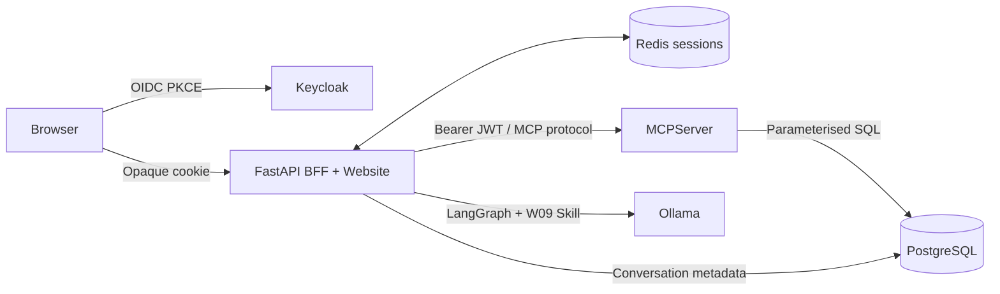

> **Publication notice:** This local-only prototype originated in a confidential recruitment assessment. Do not publish its solution publicly during the assessment window. GitHub Actions runs on private repositories too. See [SECURITY.md](SECURITY.md).

# Acme Operations Copilot — EY case-study implementation

**Implementation slices:** W01–W14 source: platform, browser IAM, LangGraph agent, escalation Skill, controlled writes, activity/telemetry, ten-case evaluation harness and submission documentation.

**Verified status (11 November 2026):** The fully tested PR #2 source revision `3437902f` passed **206 offline tests**, both Docker image builds, W07 **5/5**, W08 and W09, the W13 **10/10 structural evaluation**, real Keycloak/MCP/browser/controlled-write checks, and read-only fixture integrity. [Source CI](https://github.com/rastogivaibhav/AcmeOperationsCopilot/actions/runs/42983305290) · [Full live integration](https://github.com/rastogivaibhav/AcmeOperationsCopilot/actions/runs/42983299825). This was merged to `main` at `1a2b936d3bd3ddc77807ad170de6617e6d1f163e`; [post-merge CI](https://github.com/rastogivaibhav/AcmeOperationsCopilot/actions/runs/42984994299) passed and the [post-merge full-stack run](https://github.com/rastogivaibhav/AcmeOperationsCopilot/actions/runs/42984994525) is tracked separately. The 10/10 result is **automated structural acceptance, not independent human factual review or production certification**.

This is a fictional, local-only technical exercise. Do not upload the confidential EY candidate pack, real enterprise data, or access tokens to the repository.

## Architecture (current scope)



Keycloak stores its realm/users in the separate `keycloak` PostgreSQL schema, created idempotently by `db-init`. This replaces the H2 Docker-volume mount that failed in GitHub Actions. The demo shares a PostgreSQL instance with business data but keeps identity tables in a distinct schema; production should also use separate database credentials and hardened Keycloak configuration.

For Keycloak 26.8, the imported `acme-web` client explicitly adds the `oidc-sub-mapper` access-token subject claim and a **custom** `acme-mcp` audience. A client audience mapper pointing to a non-existent client is ignored by this version; both `sub` and `aud=acme-mcp` are required by the server-side JWT verifiers.

Keycloak runs in `start-dev` and demo passwords are intentionally disposable. The MCP server independently validates a Keycloak token with the `acme-mcp` audience. The web API independently validates it with the `acme-web` audience. The demo web client includes both audiences in its access tokens, an acceptable local simplification that **must not be reused unchanged** in production; a production implementation should use properly scoped delegation/token exchange.

## Requirements

- Docker Engine and `docker compose` plugin.
- At least 8 GB RAM suggested for local container startup + a 3B Ollama model; CPU-only inference may be slow. This is a planning estimate, not a benchmark.
- Network access on first run to pull official images, install Python dependencies and download the model.
- Ports 8000 and 8080 free on localhost.

## Boot (one command)

```bash
# In the repository root. It uses local-only defaults; edit .env before sharing.
cp .env.example .env
# first run will download multiple images and a several-GB model
# Compose builds the two custom images if missing
docker compose up --build
```

Then check:

```bash
curl http://localhost:8000/healthz
curl http://localhost:8000/readyz
# Requires running stack; exercises real Keycloak + authenticated MCP calls:
docker compose exec web python -m app.smoke
# W06 tests owner-scoped conversations and cross-user access using real Keycloak tokens:
docker compose exec web python -m app.smoke_w06
```

If you have already built the images, `docker compose up` should suffice. `db-init` applies the Alembic migration and idempotent fictional seed, while `model-init` pulls `qwen2.5:3b`. Database and model volumes persist across restarts. `docker compose down -v` **deletes all demo data, identity storage and model volumes**; do not use it inadvertently.

## Demo identities (LOCAL ONLY)

| Username | Password | Keycloak realm role |
|---|---|---|
| `sales-demo` | `SalesLocal2026!` | `sales_user` |
| `support-demo` | `SupportLocal2026!` | `support_user` |
| `admin-demo` | `AdminLocal2026!` | `admin` |

Keycloak admin: `local-admin` / `LocalOnlyChangeThis123!` by default. Change through `.env` for local use. Demo user's initial passwords live in the committed *fictional* realm fixture; never reuse or deploy these accounts publicly.

### W06 browser login and personal workspace

Open **http://localhost:8000**, click **Sign in with Keycloak**, and use a fictional local demo account shown above. The login uses Authorization Code + PKCE, one-use state, nonce validation, and Redis-backed server-side sessions. The website at `/app` shows the user's verified role and allowed capabilities. Create and view owner-scoped conversation records from the Investigations panel. The W08 browser chat endpoint calls a real LangGraph agent; W09 adds a reusable risk-assessment Skill. No responses are simulated. Full-stack agent acceptance passed on the evaluated PR source revision; see the measured evidence and limitations in [evals/report.md](evals/report.md).

**Localhost only:** browser cookie uses `HttpOnly; SameSite=Lax`; `Secure` is intentionally off because the demo uses HTTP. Token material stays in Redis; the website never reads it. In production, TLS, Secure cookies, hardened identity delegation and proper credential storage would be mandatory.

**Browser logout:** choose **Sign out** in the header to clear Redis session state and initiate Keycloak sign-out.

**Direct Grant is retained only for foundation smoke tests.** A local-only token can also be obtained through Keycloak's direct grant for smoke testing; remove it and use a dedicated integration-test client before deploying outside this fictional assessment environment:

```bash
TOKEN=$(curl -fsS http://localhost:8080/realms/acme/protocol/openid-connect/token \
  -d 'grant_type=password' -d 'client_id=acme-web' \
  -d 'username=sales-demo' -d 'password=SalesLocal2026!' \
  | python -c 'import json,sys;print(json.load(sys.stdin)["access_token"])')
curl -H "Authorization: Bearer $TOKEN" http://localhost:8000/api/me
curl -G -H "Authorization: Bearer $TOKEN" \
  --data-urlencode 'name=Acme Retail' http://localhost:8000/api/customers/find
unset TOKEN
```

The last API call is an **actual MCP protocol call**, not a REST implementation disguised as MCP. It should return a database-backed Acme Retail record when the stack is healthy. Do not paste the token into screenshots, commits or logs.

## MCP business tools

| Tool | Args | Permissions | Status in this slice |
|---|---|---|---|
| `find_customer` | customer_name | authorised read; Sales scoped | Implemented; live smoke verified |
| `list_open_issues` | customer_id | authorised read; Sales scoped | Implemented; live smoke verified |
| `get_issue_history` | issue_id | authorised read; Sales scoped | Implemented; live smoke verified |
| `create_next_action` | issue_id, description, approval_id, operation_id | Admin, recorded human approval | Implemented; live smoke verified |

**Write approval boundary:** Admin obtains a fresh, 10-minute approval receipt by explicitly calling `POST /api/approvals` with an authenticated bearer token and `confirmed: true`. The LLM/MCP layer cannot issue approvals. To commit, the authenticated admin invokes MCP `create_next_action` with the exact approval and operation IDs. PostgreSQL enforces `UNIQUE(operation_id)` for idempotency. The future web UI must provide a deliberate confirmation step and CSRF-protected BFF sessions; browser OIDC is W06.

The `issue_updates` seed includes contradictory notes and stale/missing updates to support later evaluation. The sample dates are a **2026-11-09 snapshot**, not live operational data.

## W07 — Measured local model tool calling (read-only)

After the foundation smoke tests, run the **actual** Ollama model against the authenticated MCP server:

```bash
docker compose exec web python -m app.agent.probe \
  --output /code/evals/results/w07-live.json
docker compose cp web:/code/evals/results/w07-live.json ./evals/results/w07-live.json
```

The original W07 probe dynamically loads read-only MCP tool schemas and gives them to Ollama's native `/api/chat` tool-calling endpoint; model-selected calls execute against the **real** MCP server using a verified Keycloak demo-user token. It records chosen tool order, statuses, evidence refs, time and errors across five cases. W07 passed 5/5 on the reference live run; per-case evidence is in the GitHub Actions evaluation artifact. Controlled writes remain disabled in this W07 spike. [Full W07 runbook](docs/W07-STATUS.md).

## Tests and checks

Static/unit verification with Python 3.11+:

```bash
pip install '.[test]'
sh scripts/verify_static.sh
```

To rerun the verified live checks on a machine with Docker:

```bash
docker compose config
docker compose up --build
# In another terminal:
docker compose exec web python -m app.smoke
# W06 tests owner-scoped conversations and cross-user access using real Keycloak tokens:
docker compose exec web python -m app.smoke_w06
```

GitHub Actions has completed the real Compose foundation, JWT/Keycloak and MCP smoke checks successfully. Offline `pytest` alone does **not** establish production readiness; consult the [completed full-stack run](https://github.com/rastogivaibhav/AcmeOperationsCopilot/actions/runs/42983299825).

## Deliverable boundaries

The implementation-history statements below are intentionally distinguished from verified present-day evidence.

**Historical W01–W05 implementation notes:** The first drafts predated real Docker, database migration and Keycloak/MCP validation. Those initial verification gaps were subsequently addressed with GitHub-hosted Compose runs; this sentence records development history, not the present test status.

**Current scope through W14:** OIDC/Keycloak, authenticated MCP, LangGraph/Ollama, PostgreSQL checkpointing, escalation Skill, approved business actions, browser UI, telemetry and reproducible live evaluations have all run in GitHub-hosted Compose. **Still outstanding for submission sign-off:** human review of individual facts, recommendations, the confidentiality requirements and the handover evidence; this is a local technical-assessment prototype, not a production deployment.

## References

- MCP v2 authorization: https://py.sdk.modelcontextprotocol.io/run/authorization/
- MCP v2 Streamable HTTP clients: https://py.sdk.modelcontextprotocol.io/client/transports/
- Keycloak realm import: https://www.keycloak.org/server/containers
- Keycloak health check: https://www.keycloak.org/server/health
- Compose readiness dependencies: https://docs.docker.com/compose/how-tos/startup-order/

## W06 endpoints

| Endpoint | Purpose |
|---|---|
| `GET /` | Demo landing page |
| `GET /login` | Keycloak Authorization Code + PKCE redirect |
| `GET /auth/callback` | State+nonce checked token exchange; Redis-backed browser session |
| `POST /logout` | CSRF-checked local + Keycloak sign-out |
| `GET /app` | Identity-scoped workspace and permitted capability badges |
| `GET /api/me` | Verified identity, role, capabilities and browser CSRF token |
| `GET /api/conversations` | Own conversation records only |
| `POST /api/conversations` | Create owned conversation; cookie sessions require `X-CSRF-Token` |
| `GET /api/conversations/{id}` | Conversation details; other user IDs return 404 |
| `POST /api/conversations/{id}/messages` | Owner-gated, CSRF-protected LangGraph invocation using live Ollama/MCP tool calls |

**Security note:** BFF cookie sessions and direct bearer clients are separate authentication paths. A provided but invalid `Authorization` header is rejected; it cannot fall back to a valid browser cookie. Browser POST actions must pass a synchronizer CSRF token and same-origin checks.

More: [`docs/W06-STATUS.md`](docs/W06-STATUS.md).


## W08 — Stateful agent chat and role-profile inheritance

The new `/app` workspace now includes an actual investigation chat (not a simulated chatbot). Open or create a conversation, enter a customer question, and the backend invokes **LangGraph → Ollama → Keycloak-authenticated MCP → PostgreSQL**. The model chooses tools dynamically from the real MCP tool catalogue. Completed conversation state is checkpointed in PostgreSQL, and the browser transcript is stored in owner-scoped tables.

A single enterprise blueprint supplies shared response standards. Three versioned role profiles supply distinct personas. The agent cannot receive a write tool merely because YAML says so; W08 offers only `find_customer`, `list_open_issues` and `get_issue_history`. W09 adds the model-invocable, read-only `customer_escalation_summary` Skill, now with authorised customer-name resolution. Controlled write integration remains W10.

**Run W08 live gate after Docker startup:**

```bash
docker compose exec web python -m app.agent.smoke_w08
docker compose cp web:/code/evals/results/w08-live.json ./evals/results/w08-live.json
```

This gate requires real Keycloak login, real MCP tool selection and a PostgreSQL checkpoint restored from a fresh connection. W08 passed in the [completed reference run](https://github.com/rastogivaibhav/AcmeOperationsCopilot/actions/runs/42983299825). Full details: [`docs/W08-STATUS.md`](docs/W08-STATUS.md).

**Important:** If a role/blueprint changes, W08 intentionally requires a new conversation. A finer-grained customer scope invalidation and interrupted-node retry protocol remain W10/W16 work. The app is a tested local assessment prototype; an EY handover still requires candidate review of the recorded evidence and trade-offs.


## W09 — Reusable Customer Escalation Summary Skill

W09 adds a versioned, model-selectable **`customer_escalation_summary`** local Skill that calls the *real authenticated MCP* read tools (`list_open_issues`, `get_issue_history`) and returns a typed `EscalationReport` with:

- Deterministic `Low` / `Medium` / `High` / `Critical` scoring from active priority + SLA facts (or `Unknown` when insufficient authorised evidence).
- Time-qualified issue assessments and evidence references (issue and update IDs).
- Human-review-only recommended actions, never a database write.
- Explicit missing confirmed ETA, business impact and contradictory/missing updates.
- Nested MCP tool-call event statuses and timings for observability.

All three roles inherit the same Skill but the authenticated MCP identity independently limits which customer records can be read. The model selects the Skill for relevant intents, while typed intent guidance and authenticated dependencies support reliable execution. Blueprint versions are bumped from `0.2.0` to `0.3.0`; **create a new conversation after upgrading** because existing W08 threads deliberately reject changed blueprints.

After the full stack starts, run the W09 real-transport and real-model verification:

```bash
docker compose exec web python -m app.skills.smoke_w09
docker compose cp web:/code/evals/results/w09-live.json ./evals/results/w09-live.json
```

The report checks direct authenticated Skill execution and model-selected invocation separately. Both passed in the [completed live integration](https://github.com/rastogivaibhav/AcmeOperationsCopilot/actions/runs/42983299825). Offline tests and detailed rubric: [`docs/W09-STATUS.md`](docs/W09-STATUS.md).


## W10 — Role-specific write proposals, confirmation, receipts

The identity-aware agent now exposes **non-mutating local proposal tools** only to allowed roles: Support and Admin may suggest issue status updates, and Admin may additionally suggest a new next-action record. These proposal tools are **not privileged MCP write tools** and do not approve or commit changes. An explicit browser Action Centre displays the proposed values and requires a separate user confirmation.

The actual MCP write operations are `update_issue_status` (Support/Admin) and `create_next_action` (Admin), protected by current Keycloak role, ten-minute actor-bound server-stored approval, CSRF for cookie clients, and unique operation IDs. Issue updates use optimistic versioning and record a history update; completed writes return PostgreSQL receipts. Both operations are idempotent on safe retry. Sales write attempts are denied by the application and MCP.

New endpoints:

```text
POST   /api/actions/prepare
POST   /api/actions/{approval_id}/confirm
DELETE /api/actions/{approval_id}
```

Model-selected proposals do not immediately execute writes. The UI can also prepare an action manually using an issue UUID and current `version`, then displays the exact bound payload before confirmation. Approval IDs and operation IDs never enter the LLM prompt.

**Live acceptance:**

```bash
docker compose up --build -d
docker compose exec web python -m app.smoke_w10
docker compose cp web:/code/evals/results/w10-live.json ./evals/results/w10-live.json
```

W10 smoke uses *real* Keycloak/HTTP/MCP/PostgreSQL and **mutates the fictional demo database**. Passing offline tests do not certify this integration. Detailed implementation, threat boundaries, role matrix and limitations: [W10 report](docs/W10-STATUS.md).

**Blueprint compatibility:** Role versions advance from `0.3.0` to `0.4.0`; start a fresh investigation after upgrading. Existing version-bound conversations intentionally reject changed profile definitions rather than inheriting new capabilities silently.

## W11/W12 — Agent observability and GitHub Actions

The authenticated workspace includes an **Agent activity** pane, showing the current user's execution history, tool timings, statuses and business audit outcomes. Tool events contain **only structured, redacted metadata**, never prompts or bearer tokens. Interrupted processes leave durable run records and are marked `interrupted` at next web startup if older than twenty minutes; the underlying LangGraph conversation checkpoint is preserved for user-driven continuation.

Additional authenticated endpoints:

| Endpoint | Purpose |
|---|---|
| `GET /api/activity/summary` | Owner-scoped run totals and mean duration |
| `GET /api/activity/runs?limit=20` | Recent runs owned by the caller |
| `GET /api/activity/runs/{run_id}` | Trace metadata and tool events; other users receive 404 |
| `GET /api/activity/audit` | Own authorised/denied business action event headers |

Optional local span export: set `OTEL_TRACES_EXPORTER=console` in `.env` and restart the web service. These spans include tool names and coarse execution metadata only.

Live W11 verification (requires running Docker stack):

```bash
docker compose exec web python -m app.telemetry.smoke_w11
docker compose cp web:/code/evals/results/w11-live.json ./evals/results/w11-live.json
```

### GitHub CI and deployment

Two workflows are included:

- **Acme Copilot CI** on push/PR: Python tests, static verification, browser JavaScript check, Compose configuration validation, and builds for both custom Docker images.
- **Acme Copilot Live Compose Integration** via manual workflow dispatch: starts the full local stack on a disposable GitHub runner and executes actual Keycloak/MCP/agent smoke tests, preserving evaluation JSON results as a build artifact.

**The repository already exists and is private.** The following publishing script is only for independent re-creations; it is **not needed** to share this existing repository with authorised EY reviewers:

```bash
# Recommended while the assessment confidentiality restriction applies
bash scripts/publish_github.sh --private

# Only once public sharing is permitted:
# bash scripts/publish_github.sh --public
```

Do not interpret offline success as a green live model or Docker integration result. For the work-package details and verification limits, see [`docs/W11-W12-STATUS.md`](docs/W11-W12-STATUS.md).


## W13/W14 — Measured evaluation, release and GitHub CI

The source now includes a **ten-question real-agent evaluation specification** (`evals/w13_cases.json`) and runner (`evals/run_w13.py`). Once the full stack is healthy:

```bash
docker compose exec -T web python -m evals.run_w13
docker compose cp web:/code/evals/results ./evals/results
python scripts/verify_release.py --submission
```

The actual live JSON and Markdown results from the completed reference run are available as the private GitHub Actions `acme-live-evaluation` artifact. See [evals/report.md](evals/report.md) for the **10/10 completed reference run**, the earlier 6/10 baseline, and the limitations of structural grounding checks. Complete `evals/manual_review_template.csv` after personally inspecting the model's actual outputs.

Run `python scripts/verify_release.py` for the static source manifest. It intentionally does not claim a Docker or GitHub Actions pass. Use [docs/FINAL_SUBMISSION_CHECKLIST.md](docs/FINAL_SUBMISSION_CHECKLIST.md) for final evidence, confidentiality, human review and the five EY deliverables. Earlier slice-status documents describe their original development stages.

**GitHub:** `.github/workflows/ci.yml` provides push/PR offline checks and container builds; `.github/workflows/integration.yml` is a manually triggered full-stack and model evaluation run. Actions work on private repositories. EY's confidentiality instruction means the solution should remain **private during the assessment window**; publishing publicly would share the solution.
