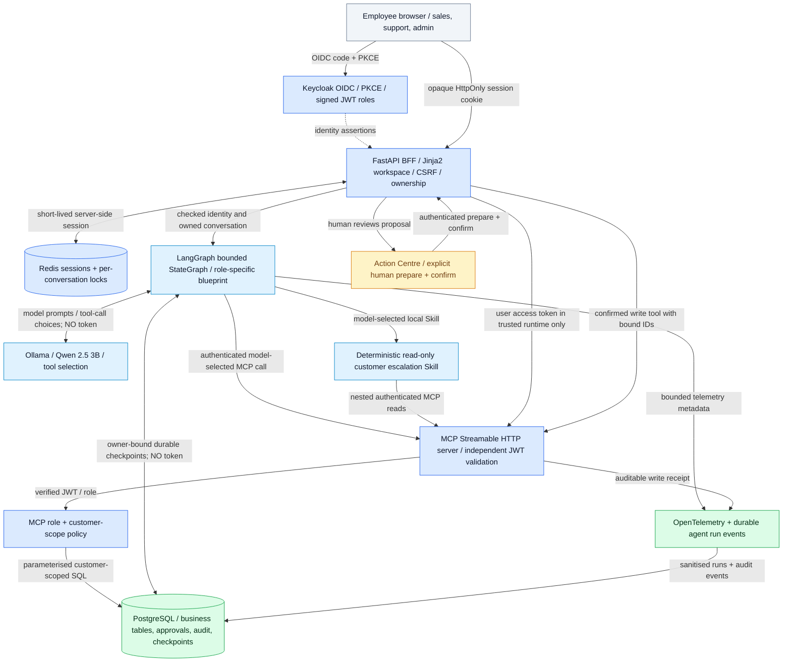
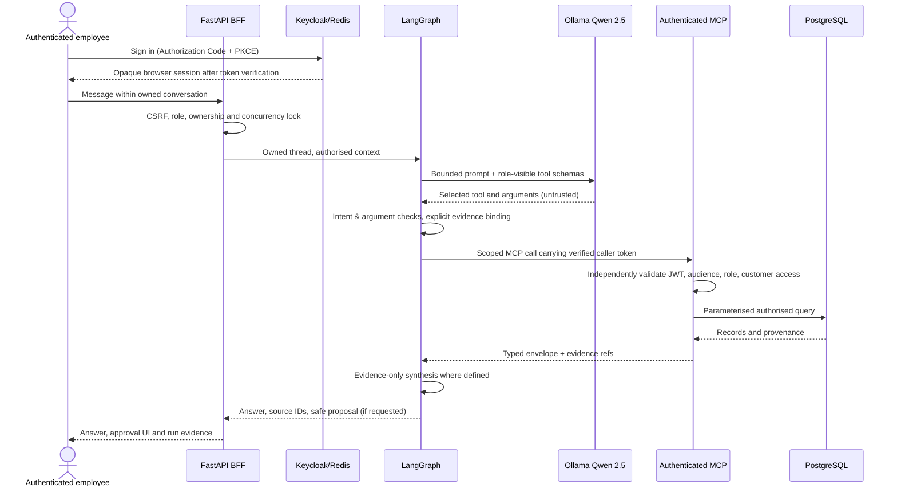

# Acme Operations Copilot — current system architecture

**Version:** as inspected on `main` in November 2026 · **Purpose:** EY panel deliverable 3. This describes the **implemented and tested** architecture, not a production target-state diagram. Original W01–W05 slice notes are historical.

## End-to-end components and data flows

The following Mermaid flowchart renders inside GitHub. Open the standalone [source diagram](architecture-current.mmd) if you wish to edit it or use a Mermaid renderer.



## Business lookup and evidence sequence



## Human-approved write sequence

```mermaid
sequenceDiagram
  actor U as Verified Support/Admin user
  participant A as LangGraph
  participant W as FastAPI BFF/Action Centre
  participant DB as PostgreSQL
  participant MCP as Authenticated MCP
  U->>A: Request status update or next action
  A->>MCP: get_issue_history (read-only precondition)
  MCP->>DB: Verify current issue/version/scope
  MCP-->>A: Authorised history + version
  A-->>U: Advisory proposal (not persisted as business write)
  U->>W: Prepare reviewed intent
  W->>DB: Store actor-bound pending approval, 10-minute expiry
  U->>W: Explicitly confirm the stored intent
  W->>DB: Recheck actor, role, expiry, exact stored payload
  W->>MCP: Authorised write with approval/operation IDs
  MCP->>DB: Validate authorisation & version, commit + audit idempotently
  DB-->>MCP: Receipt/operation ID
  MCP-->>W: Verified outcome
  W-->>U: Committed or conflict; no fabricated success
```

## What each choice protects

| Boundary | Enforcement and rationale |
|---|---|
| Browser → BFF | Keycloak OIDC, server-side Redis session, CSRF, independently checked role |
| Conversation → Graph | Owner check before checkpoint access; Redis per-thread lock; model-call/tool budgets |
| Graph → LLM | The model sees a role-specific subset of tool schemas; access tokens **never** enter model prompts/checkpoints |
| Graph/Skill → MCP | Skill may choose read operations only; MCP separately verifies JWT, customer scope and business role |
| MCP → DB | Parameterised SQL and resource filtering; no model-generated SQL |
| Proposal → Commit | Human-facing prepare/confirm, approval/operation UUIDs, version checks, idempotent receipt |
| Telemetry | Sanitised timing, tool/event labels and evidence identifiers; audit records separately bound to actor |

## Critical limitations to state aloud

1. **Identity hardening:** Keycloak runs in development mode and demo tokens contain two audiences. Production needs TLS, proper delegation/token exchange, secrets separation and identity hardening.
2. **Legacy route:** `POST /api/approvals` permits a one-request explicit Admin confirmation path. The newer Action Centre uses a separate prepare/confirm flow, but the legacy route should be removed or migrated before production.
3. **Model capability:** small local model chosen for self-contained demonstration. Ten passing evaluation cases do not prove general robustness or the semantic truth of every answer.
4. **Threat modeling:** tested role/customer denials and browser ownership, **not** an external penetration test or exhaustive prompt-injection evaluation.

## Source map

- `app/main.py`: BFF API, route security, graph invocation, Action Centre endpoints.
- `app/auth/oidc.py`, `acme_shared/policies.py`: authentication, roles and CSRF.
- `app/agent/graph.py`, `app/agent/intent.py`, `app/agent/evidence.py`: reasoning, tool selection, context and evidence.
- `app/skills/escalation.py`: deterministic risk assessment through scoped MCP.
- `app/agent/dependencies.py`, `app/action_service.py`: guarded proposal/read prerequisites and human approval.
- `mcp_server/server.py`, `mcp_server/repository.py`: independently authorised MCP and business SQL.
- `database/migrations/`, `database/fixtures/seed.sql`: schema and fictional fixtures.
- `evals/run_w13.py`, `evals/fixture_guard.py`: reproducible tests.
